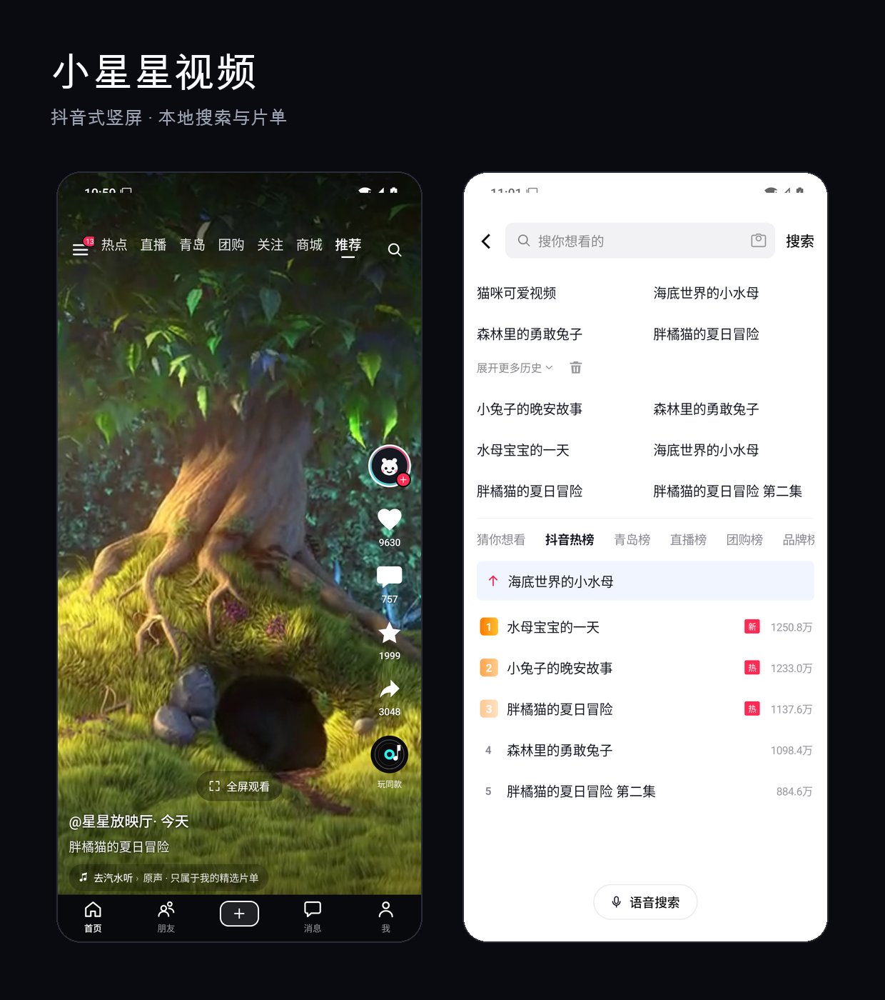

# 小星星视频

一个给小朋友使用的**纯本地、离线、无广告**短视频播放器。家长只把自己筛选过的 MP4 放进片单，孩子只能在片单内上下滑动观看。



## 功能

- 2 秒品牌启动页（抖音式暗色启动画面）
- 抖音式竖屏上下滑切换：顶部频道、右侧互动栏、底部导航、全屏观看按钮
- 视频播放完自动切换到下一个，片单循环
- 每次重新启动随机选择一个视频开始（尽量不和上次重复）
- 顶部频道栏 + 搜索入口 → 搜索页（搜索历史、热搜榜）→ 本机视频两列宫格；点击任意视频直接播放
- 播放页心形/星标可切换颜色，仅本地假互动
- 本地相册 / 文件导入 MP4，复制到 App 私有目录
- 片单管理：缩略图、时长、移除、播放顺序
- 评论、分享、唱片等按钮仅装饰；心形和星标可本地切换颜色
- 轻点显示底部细进度条，单点暂停/继续，双击暂停
- 可选铺满全屏，或保留完整画面
- 4 款可切换桌面图标
- 防沉迷时长可在片单管理里设为 0～60 分钟（0 表示关闭），只累计实际观看时间
- 不申请 INTERNET 权限，没有账号、广告、推荐算法、数据采集

## 技术栈

- 原生 Android / Java
- AndroidX ViewPager2
- Media3 ExoPlayer
- Gradle + Android Gradle Plugin
- minSdk 23 / targetSdk 35

## 搜索与宫格

搜索框输入任何内容，点击“搜索”都会进入本机视频宫格。宫格显示全部已添加视频，支持两列滚动和“全部/收藏”筛选；点击卡片会回到播放页并从该视频开始。

## 目录

```text
app/
  src/main/
    java/com/xiazongji/littlestar/
      SplashActivity.java        2 秒品牌启动页
      MainActivity.java          播放页
      ManageActivity.java        片单管理
      SearchActivity.java        搜索页
      VideoGridActivity.java     两列视频宫格
      VideoGridAdapter.java      宫格卡片适配器
      ReactionStore.java         本地点赞/收藏状态
      SearchHistoryStore.java    本地搜索历史
      VideoPagerAdapter.java     滑动分页与播放器
      VideoStore.java            导入、复制、缩略图、删除
      VideoItem.java             视频数据模型
      IconManager.java           桌面图标切换
      CrashReporter.java         崩溃日志
      CrashReportActivity.java   崩溃反馈页
    res/                         布局、样式、图标
keystore.properties.example      签名配置示例
build.sh                         本地构建脚本
安装与使用说明.md
```

## 构建

环境要求：

- JDK 17 或 21
- Android SDK Platform 35 / Build Tools 35
- Android Studio 或 Gradle 8.9+

本项目使用 Gradle Wrapper：

```bash
./gradlew assembleDebug
./gradlew assembleRelease
```

也可以使用 Android Studio 直接打开根目录构建。

### Release 签名

签名信息不提交到 Git。复制示例文件并填写自己的 keystore：

```bash
cp keystore.properties.example keystore.properties
# 编辑 keystore.properties，填写 storeFile / storePassword / keyAlias / keyPassword
```

没有 `keystore.properties` 时，`assembleRelease` 会生成未签名 APK；日常调试用 `assembleDebug` 即可。

> 升级安装必须使用同一签名证书；请自行备份 keystore 和密码。

## 发布包

本地构建的 APK 放在 `release/`，默认不提交到 Git（见 `.gitignore`）。如果要随仓库分发，可把它上传到 Git 的 Releases，或自行调整 `.gitignore`。

## 防沉迷

在“我的片单 → 防沉迷”中把时长设为 0～60 分钟。设为 0 表示关闭限制；默认 20 分钟。只累计视频实际播放的时间，达到上限后暂停，关闭 App 重开重新开始计时。

## 隐私

App 不申请 `INTERNET` 权限，视频只保存在本机 App 私有目录，卸载后删除。不会上传、同步或采集视频内容。

## 说明

图标和界面视觉参考了短视频产品的交互形式；代码和资源均可按家庭需要自行修改。
